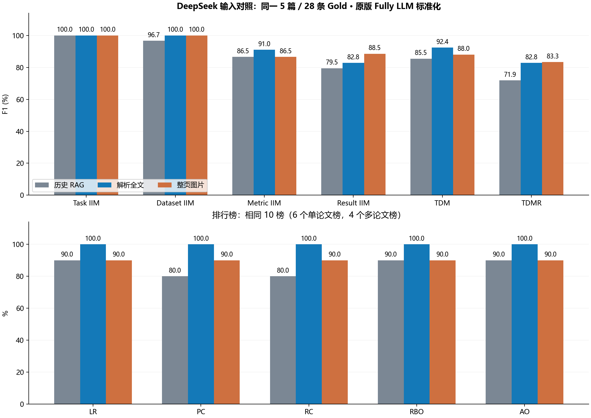

# DeepSeek 输入方式子集对照：实验结果

三组均完成 **5/5 篇、28 条 Gold**。最终 TDMR F1：历史 RAG **71.85%**，解析全文 **82.83%**，整页图片 **83.31%**。相对历史 RAG，分别提高 **10.98** 和 **11.46** 个百分点。图片组比解析全文高 **0.48** 个百分点。

## 设置与范围

| 设置 | 正文/页面 | 表格处理 | 抽取/标准化 |
|---|---|---|---|
| 历史 RAG | 每篇4个历史检索正文块 | 全部历史表格纯文本 | 复用已有 DeepSeek Fully LLM |
| 解析全文 | 原解析器保留的全部 Title/NarrativeText，按页聚合 | 同样的32张表格纯文本及原caption规则 | 5次新抽取 + 49次标准化 |
| 整页图片 | PDF全部56页，150 DPI PNG，原页序 | 表格随整页图像输入 | 5次新抽取 + 52次标准化 |

模型实际请求为 `deepseek-flash`，官方文档映射版本为 `DeepSeek-V4.1-Flash-1017`。两阶段都沿用已验证配置：thinking enabled、reasoning_effort high、stream false；未发送客户端输出上限、temperature、seed、tools或response_format。System Prompt与用户任务前后缀不变。原版Fully候选集合23/71/26及顺序、逐字段处理、精确接受规则不变；不缓存重复名称。

第一组原请求是直接输入PDF。核实[官方Vision文档](https://api-docs.deepseek.com/guides/vision)和[Files文档](https://api-docs.deepseek.com/guides/files_api)后，用户批准改成整页图片：接口不支持PDF文件，只支持图片。每页原样渲染，不OCR、不裁剪、不切图；官方服务会按约1300×1300总像素面积缩放，单图最高1024 Tokens。图片请求最大9.4 MB。

解析全文组复用已保存的Unstructured元素，直接执行原版`extract_text_and_tables`方法的缓存等价调用；未重新解析PDF。这里的“全文”指原版代码保留的Title/NarrativeText全部正文，而不是额外纳入公式、图像或其他被原版排除的元素。全部正文按原页序在前，全部表格按原序在后，未进行切块、Embedding或Chroma检索。原表格HTML保留在审计文件中，本组仍使用与历史一致的纯文本表示，32/32个表格文档逐字一致。

种子`20261029`；在43篇完整输入中，按非表格文本长度与表格数的中位数分成四层，每层抽一篇，再随机补一篇。抽样没有使用Gold数量、答案或模型得分；清单在新请求前冻结。

| 论文 | Gold | 页数/表格 | 三组预测条数（RAG/全文/图片） | RAG TDMR F1 | 全文 TDMR F1 | 图片 TDMR F1 |
|---|---|---|---|---|---|---|
| D19-1367.pdf | 2 | 6 / 2 | 3/3/2 | 40.00 | 80.00 | 100.00 |
| 1901.10430.pdf | 8 | 14 / 7 | 9/9/8 | 82.35 | 94.12 | 100.00 |
| 1808.08745.pdf | 3 | 11 / 6 | 5/5/5 | 50.00 | 75.00 | 50.00 |
| 2020.emnlp-main.523.pdf | 11 | 13 / 12 | 7/7/11 | 77.78 | 55.56 | 63.64 |
| 1911.09483.pdf | 4 | 12 / 5 | 4/4/4 | 100.00 | 100.00 | 100.00 |

## 完整最终指标

以下均为百分数。官方逐篇Macro Precision/Recall保持原样；F1=2PR/(P+R)，并非逐篇F1的算术平均。

| 指标 | 历史RAG P/R/F1 | 解析全文 P/R/F1 | 整页图片 P/R/F1 |
|---|---|---|---|
| Task IIM | 100.00 / 100.00 / 100.00 | 100.00 / 100.00 / 100.00 | 100.00 / 100.00 / 100.00 |
| Dataset IIM | 96.67 / 96.67 / 96.67 | 100.00 / 100.00 / 100.00 | 100.00 / 100.00 / 100.00 |
| Metric IIM | 90.00 / 83.33 / 86.54 | 92.00 / 90.00 / 90.99 | 90.00 / 83.33 / 86.54 |
| Result IIM | 76.44 / 82.73 / 79.46 | 77.40 / 89.09 / 82.83 | 84.73 / 92.73 / 88.55 |
| TDM Exact Match | 87.50 / 83.56 / 85.48 | 92.00 / 92.73 / 92.36 | 90.00 / 86.06 / 87.99 |
| TDMR Exact Match | 70.22 / 73.56 / 71.85 | 77.40 / 89.09 / 82.83 | 80.73 / 86.06 / 83.31 |

严格Result数值相等的辅助P/R/F1与本次官方Result IIM完全一致。它只核对Result值，不核对对应Task/Dataset/Metric；详细记录见evaluation及metrics.csv。标准化前的官方精确名称评价也已保存，未将其称为语义抽取分数。

## 排行榜指标

从冻结的27个Gold排行榜中，仅保留本次5篇成员的交集：10榜、14个论文成员条目，其中6榜只有1篇，4榜各有2篇。三组使用完全相同的派生Gold。PC/RC/RBO由原官方代码生成；LR、有效非空榜率和论文ID AO沿用既有辅助定义。

| 指标 | 历史 RAG | 解析全文 | 整页图片 |
|---|---|---|---|
| LR | 90.00 | 100.00 | 90.00 |
| 有效非空榜率 | 90.00 | 100.00 | 90.00 |
| PC | 80.00 | 100.00 | 90.00 |
| RC | 80.00 | 100.00 | 90.00 |
| 官方数值RBO | 90.00 | 100.00 | 90.00 |
| 论文ID AO | 90.00 | 100.00 | 90.00 |

解析全文组在这10榜上全命中。ReCoRD不属于这10榜，其Dev/Test混淆影响tuple指标，但不进入上述排行榜分母。多论文榜的逐榜成员和排序保存在evaluation报告中，便于检查实际排序变化。

## 哪个环节影响结果

### 1. D19-1367：纯文本表格表示损失，叠加正文检索遗漏

第4页Table 2的HTML保留了I-DARTS的**93.47**，但同一元素的`text`只有模型名称，没有分数列；原caption关联还把它配成了Figure 2。历史RAG的4段正文也没有93.47，因此原输出为NER `N/A`。完整正文中另有明确的“93.47 F1-score”，解析全文组恢复该记录；图片组也抽出56.0与93.47两条Gold。

该篇TDMR F1从 **40→80→100**。全文组还输出验证集Perplexity 58.0，图片组只保留两项测试结果。问题发生在“HTML/元素到纯文本上下文”的信息保留及正文选择两个位置。

### 2. LUKE（2020.emnlp-main.523）：上下文更多，Dev/Test选择仍会出错

历史RAG选中了ReCoRD测试值 **90.6/91.2**。解析全文组改为输出开发值 **90.8/91.4**，漏掉测试值；图片组把开发值和测试值都输出，还加入SQuAD开发值89.8/95.0。原版标准化把带Dev/Test的Metric都映射成EM/F1，限定信息随后消失。

三组都漏掉Open Entity与TACRED的Precision/Recall，共4条Gold，即使这些列在PDF表格上清晰存在。该篇TDMR F1为 **77.78→55.56→63.64**。这属于Extraction对最佳结果、指标列及实验split的选择问题，增加输入并未自动解决。

### 3. XSum（1808.08745）：正确抽取被标准化拒绝

三组均抽到了31.89、11.54、25.75三个正确ROUGE值。图片组在标准化`ROUGE-1 F1`时返回了带单引号的`'ROGUE-1'`，不与候选`ROGUE-1`精确相等，按原规则保存为null。解析全文组的**同一个请求，参数和消息哈希完全一致**，返回的是不带引号的候选，因此被接受。

该篇TDMR F1为 **50→75→50**。三组还都输出了Gold未收录的人评/QA结果。最终差值包含重复LLM标准化带来的返回波动，不能把这部分计为RAG或图片输入的收益；所有原答案和null均保留，未修复。

### 汇总判断

- **本次最直接的输入收益是补回被遗漏的证据。** 两种新输入都修复了D19-1367的NER数值遗漏，图片组Result IIM F1达到88.55%，高于全文82.83%和RAG79.46%。
- **更多上下文也会引入更多实验条件。** LUKE的开发/测试结果是最明显的退化案例，表明结果选择与绑定仍是抽取层问题。
- **标准化仍会损伤正确抽取。** XSum相同请求的一次引号差异就使正确记录和相应排行榜丢失；本轮保留原始精确接受规则，因此结果呈现了这一真实波动。
- 每篇每组只执行一次。样本覆盖5篇、28条Gold；此次选样同时含提升、退化和持平论文，观察到的变化用于定位问题，未据此更改全量冻结结果。

## 请求与运行记录

| 设置 | 抽取请求 | 标准化请求 | 输入Token | 输出Token（含推理） | 总Token |
|---|---|---|---|---|---|
| 历史 RAG | 5 | 43 | 31339 | 29373 | 60712 |
| 解析全文 | 5 | 49 | 56307 | 20488 | 76795 |
| 整页图片 | 5 | 52 | 73851 | 13367 | 87218 |

历史RAG行是复用的历史用量；本轮新增 **111次**（抽取10次、标准化101次），输入130,158、输出33,855、总计 **164,013 Tokens**。全部HTTP200、finish_reason=stop；无重试、无失败、无模型切换。两条独立串行队列并行执行，批次墙钟153.8秒，HTTP耗时加总274.5秒。

准备阶段复用了本地tokenizer缓存；PATH中的MiKTeX因配置目录权限导致渲染失败，随后使用项目原有独立Poppler完成渲染，失败日志保留。未安装依赖、未修改原PDF或冻结环境。

## 文件索引

- `selection_frozen.json` / `input_manifest.json`：抽样与输入。
- `page_images/fully/`：图片组逐篇原响应、标准化、检查点与用量。
- `parsed_full/fully/`：解析全文组同类产物。
- `baseline_rag/merged/`：同5篇历史RAG结果的只读来源副本。
- `evaluation/report.json`：所有官方P/R/F1、逐篇指标和逐榜结果；`evaluation/latest.json`定位本轮完整评价。
- `metrics.csv` / `per_paper_metrics.csv`：汇总和逐篇表。
- `inspection/cases.json`：三个案例的输入证据、原始预测及标准化返回。
- `api_usage_summary.json` / `request_manifest.csv`：新旧请求分开统计。
- `verification.json`：源码、Gold、Prompt、证据、历史结果及新请求的一致性核验。

后续未自动扩展到43篇，也未修改名称对齐Prompt或进行结果修复。
