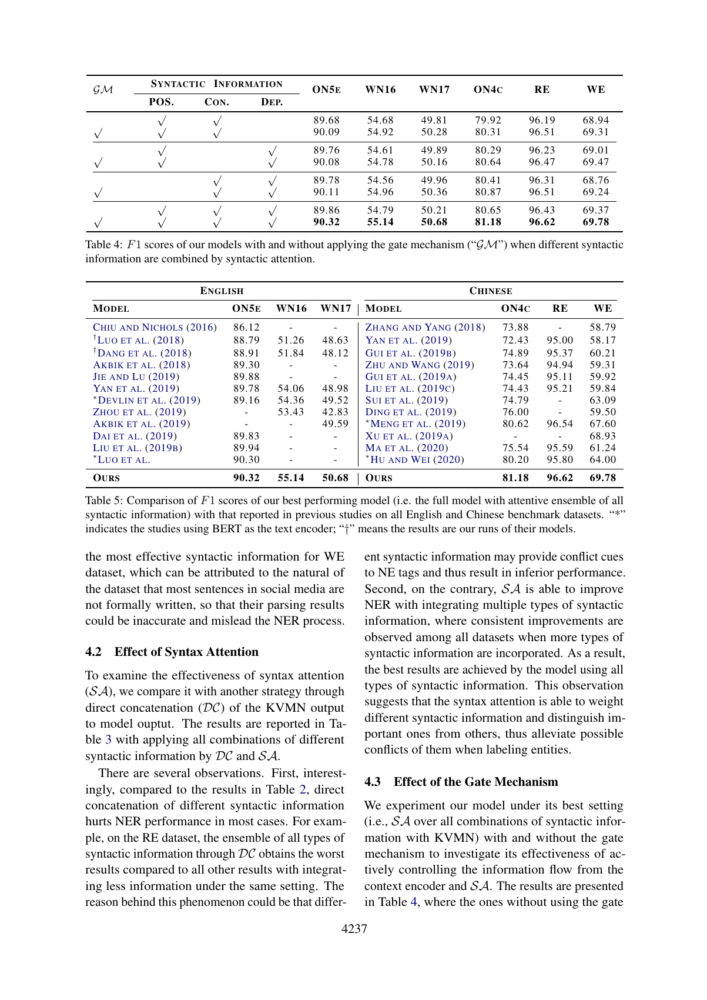
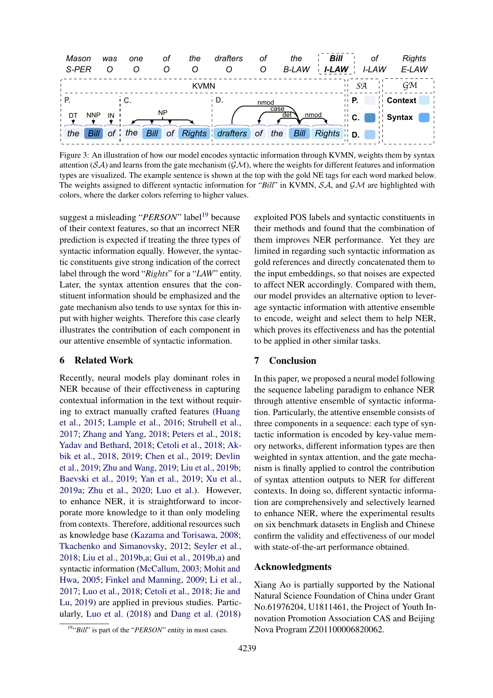
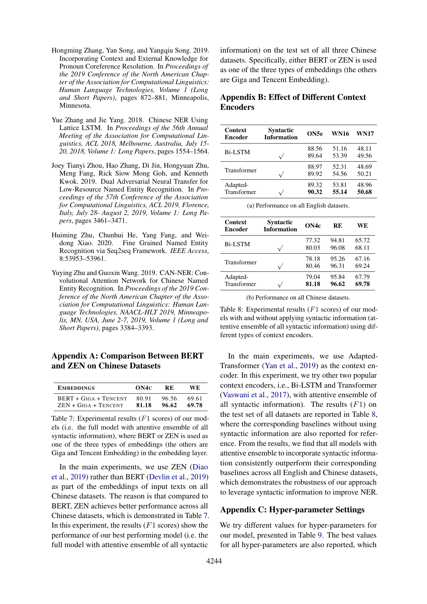

# SciLead 单篇预处理人工检查报告

论文：Improving Named Entity Recognition with Attentive Ensemble of Syntactic Information；文件：`2020.findings-emnlp.378.pdf`；15 页。

结果：CPU hi_res 表格推理与原始 MPNet/Chroma 检索实际完成；25 个文本块、245 个元素、12 个 Table 区域、16 条证据（4 Text + 12 Table）。耗时 108.86 秒。

## 质量核验与限制

- 12 个 Table 检测区域并非 12 张独立真实表：第 9 页 Figure 3 被误检；Table 8 的 (a)/(b) 子表在第 14 页分为两个区域。
- 视觉核对第 7、9、14 页。第 7 页 Table 5 OURS 的六个结果值与 Gold 一致，并完整出现在官方证据文本中。
- Table 8(a) 的官方表格文档没有标题，8(b) 仅附带子标题，完整 Table 8 标题未被附加；报告中的对应关系来自人工视觉核对。
- 复杂表格原始文本会按列展平、勾选标记脱离行，不能把数值存在当作逐单元格结构完全准确。未全面核验其余表格单元格。
- 不修改或删除误检证据，不校正原始文本，不更改官方 processed_docs.pkl；下一阶段需保留这些误差作为预处理边界。

## Gold 结果对照（NER / F1，第 7 页 Table 5）

| Gold 数据集 | Gold 结果 | 原始证据中存在 |
|---|---:|---|
| Ontonotes v5 - English | 90.32 | 是；已视觉核对 OURS 行 |
| WNUT-16 - English | 55.14 | 是；已视觉核对 OURS 行 |
| WNUT-17 - English | 50.68 | 是；已视觉核对 OURS 行 |
| Ontonotes v4 - Chinese | 81.18 | 是；已视觉核对 OURS 行 |
| Resume - Chinese | 96.62 | 是；已视觉核对 OURS 行 |
| Weibo - Chinese | 69.78 | 是；已视觉核对 OURS 行 |

## 可视化抽查

### PDF 第 7 页



### PDF 第 9 页



### PDF 第 14 页



## 全部表格区域（保留原始文本及 HTML）

### 区域 1 / 第 5 页 / Table 1: dataset statistics

上面的表号映射是检查记录，不写回官方输出。以下为官方原始表格文档（含其实际附加的标题）：

```text
Table 1: Statistics of all datasets with respect to the number of NE types (T.), sentences (S.), and total NEs (E.).
ENGLISH CHINESE TYPE ON5E WN16 WN17 ON4C RE WE # T. = 18 # T. = 10 # T. = 6 # T. = 4 # T. = 8 # T. = 4 # S. # E. # S. # E. # S. # E. # S. # E. # S. # E. # S. # E. TRAIN 59.9K 81.8K 8.5K 11.1K DEV 8.3K 11.3K TEST 2.4K 1.0K 3.9K 1.5K 0.7K 3.5K 3.4K 1.0K 1.3K 2.0K 15.7K 13.4K 7.0K 4.3K 0.8K 7.7K 4.3K 1.1K 3.8K 13.4K 1.5K 0.5K 1.6K 0.5K 1.4K 0.3K 0.3K 1.9K 0.4K 0.4K
```

Unstructured 原始表格 HTML：

```html
<table><thead><th rowspan="3">TYPE</th><th colspan="6">ENGLISH</th><th colspan="6">CHINESE</th></thead><thead><th></th><th colspan="2" rowspan="2">ONS5E #T.=18</th><th colspan="2" rowspan="2">WNI16 #T.=10</th><th colspan="2" rowspan="2">WNI17 #7. =6</th><th colspan="2" rowspan="2">ON4c #T.=4</th><th colspan="2" rowspan="2">RE #T.=8</th><th colspan="2" rowspan="2">WE #T.=4</th></thead><thead><th></th><th colspan="2"></th><th colspan="2"></th><th colspan="2"></th><th colspan="2"></th><th colspan="2"></th><th colspan="2"></th></thead><tr><td>TRAIN</td><td>59.9K</td><td>81.8K</td><td>24K</td><td>1.5K</td><td>34K</td><td>2.0K</td><td>15.7K</td><td>134K</td><td>3.8K</td><td>134K</td><td>14K</td><td>1.9K</td></tr><tr><td>DEV</td><td>85K</td><td>I1IK</td><td>1.0K</td><td>0.7K</td><td>1.0K</td><td>08K</td><td>4.3K</td><td>7.0K</td><td>0.5K</td><td>1.5K</td><td>0.3K</td><td>0.4K</td></tr><tr><td>Test</td><td>8.3K</td><td>113K</td><td>3.9K</td><td>3.5K</td><td>1.3K</td><td>1.1K</td><td>4.3K</td><td>7.7K</td><td>0.5K</td><td>1.6K</td><td>0.3K</td><td>0.4K</td></tr></table>
```

### 区域 2 / 第 6 页 / Table 2: individual syntactic information

上面的表号映射是检查记录，不写回官方输出。以下为官方原始表格文档（含其实际附加的标题）：

```text
Table 2: F 1 scores of the baseline model and ours enhanced with different types of syntactic information (“POS.”, “CON.” and “DEP.” refer to POS labels, syntactic constituents and dependency relations, respectively).
SYNTACTIC INFORMATION ON5E WN16 WN17 ON4C RE WE POS. CON. DEP. √ √ √ 89.32 89.51 89.64 89.58 53.81 53.94 54.59 54.37 48.96 49.68 49.82 49.47 79.04 79.53 79.76 80.03 95.84 96.09 96.11 96.02 67.79 68.76 68.11 68.64
```

Unstructured 原始表格 HTML：

```html
<table><thead><th>SYNTACTIC</th><th colspan="2">INFORMATION</th><th rowspan="2">ONSE</th><th rowspan="2">WN16</th><th rowspan="2">WNI17</th><th rowspan="2">ON4c</th><th rowspan="2">RE</th><th rowspan="2">WE</th></thead><thead><th>POS.</th><th>CON.</th><th>DEP.</th><th></th><th></th><th></th><th></th><th></th><th></th></thead><tr><td rowspan="4">JV</td><td rowspan="4">vA</td><td></td><td>89.32</td><td>53.81</td><td>48.96</td><td>79.04</td><td>95.84</td><td>67.79</td></tr><tr><td></td><td></td><td></td><td>89.51</td><td>53.94</td><td>49.68</td><td>79.53</td><td>96.09</td><td>68.76</td></tr><tr><td></td><td></td><td></td><td>89.64</td><td>54.59</td><td>49.82</td><td>79.76</td><td>96.11</td><td>68.11</td></tr><tr><td></td><td></td><td>vA</td><td>89.58</td><td>54.37</td><td>49.47</td><td>80.03</td><td>96.02</td><td>68.64</td></tr></table>
```

### 区域 3 / 第 6 页 / Table 3: syntax combinations

上面的表号映射是检查记录，不写回官方输出。以下为官方原始表格文档（含其实际附加的标题）：

```text
Table 3: F 1 scores of our models with different combinations of syntactic information. “TYPE” indicates how they are combined, where “DC” and “SA” refer to direct concatenation and syntax attention, respectively.
TYPE SYNTACTIC INFORMATION ON5E WN16 WN17 ON4C RE WE DC POS. √ √ √ CON. √ √ √ DEP. √ √ √ 89.61 89.56 89.60 89.62 54.11 54.03 54.26 54.41 49.61 49.74 49.58 49.63 79.61 79.83 79.89 79.81 95.72 96.11 96.08 95.31 68.27 68.51 68.36 68.49 SA √ √ √ √ √ √ √ √ √ 89.68 89.76 89.78 89.86 54.68 54.61 54.56 54.79 49.81 49.89 49.96 50.21 79.92 80.29 80.41 80.65 96.19 96.23 96.31 96.43 68.94 69.01 68.76 69.37
```

Unstructured 原始表格 HTML：

```html
<table><thead><th rowspan="2">TYPE</th><th colspan="3">SYNTACTIC INFORMATION</th><th rowspan="2">ON5E</th><th rowspan="2">WN16</th><th rowspan="2">WN17</th><th rowspan="2">ON4C</th><th rowspan="2">RE</th><th rowspan="2">WE</th></thead><thead><th></th><th>POS.</th><th>CON.</th><th>DEP.</th><th></th><th></th><th></th><th></th><th></th><th></th></thead><tr><td rowspan="4">DC</td><td>vA</td><td>vA</td><td></td><td>89.61</td><td>54.11</td><td>49.61</td><td>79.61</td><td>95.72</td><td>68.27</td></tr><tr><td></td><td>vA</td><td></td><td>vA</td><td>89.56</td><td>54.03</td><td>49.74</td><td>79.83</td><td>96.11</td><td>68.51</td></tr><tr><td></td><td></td><td>vA</td><td>vA</td><td>89.60</td><td>54.26</td><td>49.58</td><td>79.89</td><td>96.08</td><td>68.36</td></tr><tr><td></td><td>J</td><td>J</td><td>J</td><td>89.62</td><td>54.41</td><td>49.63</td><td>79.81</td><td>95.31</td><td>68.49</td></tr><tr><td rowspan="4">SA</td><td></td><td>vA</td><td>vA</td><td></td><td>89.68</td><td>54.68</td><td>49.81</td><td>79.92</td><td>96.19</td><td>68.94</td></tr><tr><td></td><td>vA</td><td></td><td>vA</td><td>89.76</td><td>54.61</td><td>49.89</td><td>80.29</td><td>96.23</td><td>69.01</td></tr><tr><td></td><td>vA</td><td>vA</td><td>89.78</td><td>54.56</td><td>49.96</td><td>80.41</td><td>96.31</td><td>68.76</td></tr><tr><td></td><td>vA</td><td>vA</td><td>vA</td><td>89.86</td><td>54.79</td><td>50.21</td><td>80.65</td><td>96.43</td><td>69.37</td></tr></table>
```

### 区域 4 / 第 7 页 / Table 4: gate mechanism

上面的表号映射是检查记录，不写回官方输出。以下为官方原始表格文档（含其实际附加的标题）：

```text
Table 4: F 1 scores of our models with and without applying the gate mechanism (“GM”) when different syntactic information are combined by syntactic attention.
GM SYNTACTIC INFORMATION ON5E WN16 WN17 ON4C RE WE √ POS. √ √ CON. √ √ DEP. 89.68 90.09 54.68 54.92 49.81 50.28 79.92 80.31 96.19 96.51 68.94 69.31 √ √ √ √ √ 89.76 90.08 54.61 54.78 49.89 50.16 80.29 80.64 96.23 96.47 69.01 69.47 √ √ √ √ √ 89.78 90.11 54.56 54.96 49.96 50.36 80.41 80.87 96.31 96.51 68.76 69.24 √ √ √ √ √ √ √ 89.86 90.32 54.79 55.14 50.21 50.68 80.65 81.18 96.43 96.62 69.37 69.78
```

Unstructured 原始表格 HTML：

```html
<table><thead><th rowspan="2">GM</th><th colspan="3">SYNTACTIC INFORMATION</th><th rowspan="2">ONSE</th><th rowspan="2">WNI6</th><th rowspan="2">WNI7</th><th rowspan="2">~~ ON4C</th><th rowspan="2">RE</th><th rowspan="2">WE</th></thead><thead><th></th><th>POS.</th><th>Con.</th><th>DEP.</th><th></th><th></th><th></th><th></th><th></th><th></th></thead><tr><td>Vv</td><td>Vv Vv</td><td>Vv Vv</td><td></td><td>89.68 90.09</td><td>54.68 54.92</td><td>49.81 50.28</td><td>79.92 80.31</td><td>96.19 96.51</td><td>68.94 69.31</td></tr><tr><td>Vv</td><td>Vv Vv</td><td></td><td>Vv Vv</td><td>89.76 90.08</td><td>54.61 54.78</td><td>49.89 50.16</td><td>80.29 80.64</td><td>96.23 96.47</td><td>69.01 69.47</td></tr><tr><td>Vv</td><td></td><td>Vv Vv</td><td>Vv Vv</td><td>89.78 90.11</td><td>54.56 54.96</td><td>49.96 50.36</td><td>80.41 80.87</td><td>96.31 96.51</td><td>68.76 69.24</td></tr><tr><td>Vv</td><td>Vv Vv</td><td>Vv Vv</td><td>Vv Vv</td><td>89.86 90.32</td><td>54.79 55.14</td><td>50.21 50.68</td><td>80.65 81.18</td><td>96.43 96.62</td><td>69.37 69.78</td></tr></table>
```

### 区域 5 / 第 7 页 / Table 5: comparison with previous studies

上面的表号映射是检查记录，不写回官方输出。以下为官方原始表格文档（含其实际附加的标题）：

```text
Table 5: Comparison of F 1 scores of our best performing model (i.e. the full model with attentive ensemble of all syntactic information) with that reported in previous studies on all English and Chinese benchmark datasets. “*” indicates the studies using BERT as the text encoder; “†” means the results are our runs of their models.
ENGLISH CHINESE MODEL ON5E WN16 WN17 MODEL ON4C RE WE CHIU AND NICHOLS (2016) †LUO ET AL. (2018) †DANG ET AL. (2018) AKBIK ET AL. (2018) JIE AND LU (2019) YAN ET AL. (2019) ∗DEVLIN ET AL. (2019) ZHOU ET AL. (2019) AKBIK ET AL. (2019) DAI ET AL. (2019) LIU ET AL. (2019B) ∗LUO ET AL. 86.12 88.79 88.91 89.30 89.88 89.78 89.16 - - 89.83 89.94 90.30 - 51.26 51.84 - - 54.06 54.36 53.43 - - - - - 48.63 48.12 - - 48.98 49.52 42.83 49.59 - - - ZHANG AND YANG (2018) YAN ET AL. (2019) GUI ET AL. (2019B) ZHU AND WANG (2019) GUI ET AL. (2019A) LIU ET AL. (2019C) SUI ET AL. (2019) DING ET AL. (2019) ∗MENG ET AL. (2019) XU ET AL. (2019A) MA ET AL. (2020) ∗HU AND WEI (2020) 73.88 72.43 74.89 73.64 74.45 74.43 74.79 76.00 80.62 - 75.54 80.20 - 95.00 95.37 94.94 95.11 95.21 - - 96.54 - 95.59 95.80 58.79 58.17 60.21 59.31 59.92 59.84 63.09 59.50 67.60 68.93 61.24 64.00 OURS 90.32 55.14 50.68 OURS 81.18 96.62 69.78
```

Unstructured 原始表格 HTML：

```html
<table><thead><th colspan="4">ENGLISH</th><th colspan="4">CHINESE</th></thead><thead><th>MODEL</th><th>ONSE</th><th>WNI16</th><th>WNI17</th><th>| MODEL</th><th>ON4c</th><th>RE</th><th>WE</th></thead><tr><td>CHIU AND NICHOLS (2016)</td><td>86.12</td><td>-</td><td>-</td><td>ZHANG AND YANG (2018)</td><td>— 73.88</td><td>-</td><td>58.79</td></tr><tr><td>¥Luo ET AL. (2018)</td><td>88.79</td><td>51.26</td><td>48.63</td><td>| YAN ET AL. (2019)</td><td>72.43</td><td>95.00</td><td>58.17</td></tr><tr><td>1DANG ET AL. (2018)</td><td>88.91</td><td>51.84</td><td>48.12</td><td>| GULET AL. (2019B)</td><td>74.89</td><td>95.37</td><td>60.21</td></tr><tr><td>AKBIK ET AL. (2018)</td><td>89.30</td><td>-</td><td>-</td><td>ZHU AND WANG (2019)</td><td>73.64</td><td>94.94</td><td>59.31</td></tr><tr><td>JIE AND Lu (2019)</td><td>89.88</td><td>-</td><td>-</td><td>GUI ET AL. (2019A)</td><td>74.45</td><td>95.11</td><td>59.92</td></tr><tr><td>YAN ET AL. (2019)</td><td>89.78</td><td>54.06</td><td>48.98</td><td>| LIU ETAL. (2019c)</td><td>74.43</td><td>95.21</td><td>59.84</td></tr><tr><td>*DEVLIN ET AL. (2019)</td><td>89.16</td><td>54.36</td><td>49.52</td><td>| SULET AL. (2019)</td><td>74.79</td><td>-</td><td>63.09</td></tr><tr><td>ZHOU ET AL. (2019)</td><td>-</td><td>53.43</td><td>42.83</td><td>| DING ETAL. (2019)</td><td>76.00</td><td>-</td><td>59.50</td></tr><tr><td>AKBIK ET AL. (2019)</td><td>-</td><td>-</td><td>49.59</td><td>| “MENG ETAL. (2019)</td><td>80.62</td><td>96.54</td><td>67.60</td></tr><tr><td>DAIET AL. (2019)</td><td>89.83</td><td>-</td><td>-</td><td>XU ETAL. (2019A)</td><td>-</td><td>-</td><td>68.93</td></tr><tr><td>LIU ET AL. (2019B)</td><td>89.94</td><td>-</td><td>-</td><td>MA ETAL. (2020)</td><td>75.54</td><td>95.59</td><td>61.24</td></tr><tr><td>*LUO ET AL.</td><td>90.30</td><td>-</td><td>-</td><td>*Hu AND WEI (2020)</td><td>80.20</td><td>95.80</td><td>64.00</td></tr><tr><td>OURS</td><td>90.32</td><td>55.14</td><td>50.68</td><td>| OURS</td><td>81.18</td><td>96.62</td><td>69.78</td></tr></table>
```

### 区域 6 / 第 8 页 / Table 6: embedding combinations

上面的表号映射是检查记录，不写回官方输出。以下为官方原始表格文档（含其实际附加的标题）：

```text
Table 6: Experimental results (F 1 scores) of our best performing model (i.e., the full model with attentive ensemble of all syntactic information) using different pre-trained embeddings and their combinations as input.
ENGLISH CHINESE EMBEDDINGS ON5E WN16 WN17 EMBEDDINGS ON4C RE WE GLOVE ELMO BERT √ √ √ √ √ √ √ √ √ √ √ √ 89.37 89.71 89.53 89.91 89.82 90.13 90.32 47.92 53.96 53.74 54.36 54.16 54.92 55.14 43.24 47.92 48.74 48.21 49.61 50.12 50.68 GIGA √ √ √ √ TENCENT ZEN √ √ √ √ √ √ √ √ 72.11 73.54 80.06 74.86 80.49 80.81 81.18 94.99 95.21 95.98 95.46 96.24 96.41 96.62 61.94 63.06 68.84 63.96 68.94 69.42 69.78
```

Unstructured 原始表格 HTML：

```html
<table><thead><th colspan="6">ENGLISH</th><th colspan="6">CHINESE</th></thead><thead><th colspan="3">EMBEDDINGS</th><th rowspan="2">ONSE</th><th rowspan="2">WN16</th><th rowspan="2">WNI7</th><th colspan="3">| EMBEDDINGS</th><th rowspan="2">ON4c</th><th rowspan="2">RE</th><th rowspan="2">WE</th></thead><thead><th>GLOVE</th><th>ELMo</th><th>BERT</th><th></th><th></th><th></th><th>| GIGA</th><th>TENCENT</th><th>ZEN</th><th></th><th></th><th></th></thead><tr><td rowspan="3">Vv</td><td></td><td></td><td>89.37</td><td>47.92</td><td>43.24</td><td>|</td><td></td><td></td><td>72.11</td><td>94.99</td><td>61.94</td></tr><tr><td></td><td>Vv</td><td></td><td>89.71</td><td>53.96</td><td>47.92</td><td></td><td>Vv</td><td></td><td>73.54</td><td>95.21</td><td>63.06</td></tr><tr><td></td><td></td><td>Vv</td><td>89.53</td><td>53.74</td><td>48.74</td><td></td><td></td><td>V</td><td>80.06</td><td>95.98</td><td>68.84</td></tr><tr><td>Vv</td><td>Vv</td><td></td><td>89.91</td><td>54.36</td><td>48.21</td><td>|</td><td>Vv</td><td></td><td>74.86</td><td>95.46</td><td>63.96</td></tr><tr><td rowspan="2">Vv</td><td></td><td></td><td>Vv</td><td>89.82</td><td>54.16</td><td>49.61</td><td>|</td><td></td><td>Vv</td><td>80.49</td><td>96.24</td><td>68.94</td></tr><tr><td>Vv</td><td>Vv</td><td>-:90.13</td><td>54.92</td><td>50.12</td><td></td><td>Vv</td><td>Vv</td><td>-80.81</td><td>= «96.41</td><td>69.42</td></tr><tr><td>Vv</td><td>Vv</td><td>Vv</td><td>-90.32-</td><td>55.14</td><td>50.68</td><td>|</td><td>Vv</td><td>V</td><td>81.18</td><td>96.62</td><td>69.78</td></tr></table>
```

### 区域 7 / 第 9 页 / FALSE POSITIVE: Figure 3

上面的表号映射是检查记录，不写回官方输出。以下为官方原始表格文档（含其实际附加的标题）：

```text
Figure 3: An illustration of how our model encodes syntactic information through KVMN, weights them by syntax attention (SA) and learns from the gate mechanism (GM), where the weights for different features and information types are visualized. The example sentence is shown at the top with the gold NE tags for each word marked below. The weights assigned to different syntactic information for “Bill” in KVMN, SA, and GM are highlighted with colors, where the darker colors referring to higher values.
Mason was one of the drafters of the Rights S-PER O oO oO oO oO oO B-LAW E-LAW re KVMN SA i GM iP. | C. 'D. nmod uP || Context 1 NP ' case 4 ' ' ' ' or NNP IN | let\ _nmo i Cc. es: Syntax a: the (Bi of | the (Bill) of Rights)| drafters of the | Bill) Rights \\p. (1;
```

Unstructured 原始表格 HTML：

```html
<table><thead><th>Mason SPER</th><th></th><th>was O</th><th>one O</th><th>of o</th><th>the 800</th><th>drafters O</th><th></th><th>of O</th><th></th><th></th><th>the BLAW</th><th>|</th><th>Bil! FLAW '</th><th>of /-LAW</th><th>Rights E-LAW</th></thead><tr><td></td><td></td><td></td><td></td><td>BO</td><td>KVMN</td><td></td><td></td><td></td><td></td><td></td><td></td><td>|</td><td></td><td>i</td><td>NSA GM</td></tr><tr><td colspan="16">P. c. D nmod 1 P. || Context casi i uy ' 5</td></tr><tr><td>DT</td><td>NNP</td><td>f IN H</td><td></td><td>NP</td><td></td><td>1 '</td><td></td><td></td><td></td><td>fet</td><td>nmot</td><td>4</td><td>"¢,</td><td>| B</td><td>Syntax (i)</td></tr><tr><td></td><td></td><td></td><td></td><td></td><td></td><td>\ 1</td><td>‘drafters</td><td>of</td><td></td><td>the</td><td>Bill)</td><td>Rights</td><td>': p.</td><td></td><td></td></tr></table>
```

### 区域 8 / 第 14 页 / Table 7: BERT vs ZEN

上面的表号映射是检查记录，不写回官方输出。以下为官方原始表格文档（含其实际附加的标题）：

```text
Table 7: Experimental results (F 1 scores) of our mod- els (i.e. the full model with attentive ensemble of all syntactic information), where BERT or ZEN is used as one of the three types of embeddings (the others are Giga and Tencent Embedding) in the embedding layer.
EMBEDDINGS ON4C RE WE BERT + GIGA + TENCENT ZEN + GIGA + TENCENT 80.91 81.18 96.56 96.62 69.61 69.78
```

Unstructured 原始表格 HTML：

```html
<table><thead><th>EMBEDDINGS</th><th>ON4c</th><th>RE</th><th>WE</th></thead><tr><td>BERT + GIGA + TENCENT</td><td>80.91</td><td>96.56</td><td>69.61</td></tr><tr><td>ZEN + GIGA + TENCENT</td><td>81.18</td><td>96.62</td><td>69.78</td></tr></table>
```

### 区域 9 / 第 14 页 / Table 8(a): English context encoders

上面的表号映射是检查记录，不写回官方输出。以下为官方原始表格文档（含其实际附加的标题）：

```text
Context Encoder Syntactic Information ON5e WN16 WN17 Bi-LSTM √ 88.56 89.64 51.16 53.39 48.11 49.56 Transformer √ 88.97 89.92 52.31 54.56 48.69 50.21 Adapted- Transformer √ 89.32 90.32 53.81 55.14 48.96 50.68
```

Unstructured 原始表格 HTML：

```html
<table><thead><th>Context Encoder</th><th>Syntactic Information</th><th>ONSe</th><th>WN16</th><th>WNI7</th></thead><tr><td>. Bi-LSTM</td><td>V</td><td>88.56 89.64</td><td>51.16 5339</td><td>48.11 49.56</td></tr><tr><td></td><td></td><td>88.97</td><td>52.31</td><td>48.69</td></tr><tr><td>Transf Fanstormer</td><td>Vv</td><td>39.92</td><td>54.56</td><td>50.21</td></tr><tr><td>Adapted-</td><td></td><td>89.32</td><td>53.81</td><td>48.96</td></tr><tr><td>Transformer</td><td>J</td><td>90.32</td><td>55.14</td><td>50.68</td></tr></table>
```

### 区域 10 / 第 14 页 / Table 8(b): Chinese context encoders

上面的表号映射是检查记录，不写回官方输出。以下为官方原始表格文档（含其实际附加的标题）：

```text
(b) Performance on all Chinese datasets.
Context Encoder Syntactic Information ON4c RE WE Bi-LSTM √ 77.32 80.03 94.81 96.08 65.72 68.11 Transformer √ 78.18 80.46 95.26 96.31 67.16 69.24 Adapted- Transformer √ 79.04 81.18 95.84 96.62 67.79 69.78
```

Unstructured 原始表格 HTML：

```html
<table><thead><th>Context Encoder</th><th>Syntactic Information</th><th>ON4c</th><th>RE</th><th>WE</th></thead><tr><td>. BiLSTM</td><td>Vv</td><td>77.32, 80.03</td><td>94.81 96.08</td><td>65.72 68.11</td></tr><tr><td>Transformer</td><td></td><td></td><td></td><td></td></tr><tr><td>Adapted-</td><td>J</td><td>79.04</td><td>95.84</td><td>67.79</td></tr><tr><td>Transformer</td><td>J</td><td>81.18</td><td>96.62</td><td>69.78</td></tr></table>
```

### 区域 11 / 第 15 页 / Table 9: hyperparameters

上面的表号映射是检查记录，不写回官方输出。以下为官方原始表格文档（含其实际附加的标题）：

```text
Table 9: Values tested for different hyper-parameters and the best one used in our experiments.
VALUES BEST DROPOUT RATE LEARNING RATE BATCH SIZE NUMBER OF LAYERS NUMBER OF HEAD HIDDEN UNITS 0, 0.1, 0.2, 0.3 e−5, e−4, e−3 8, 16, 32 1, 2, 4 4, 8, 12 64, 128, 256 0.2 e−4 32 2 12 128
```

Unstructured 原始表格 HTML：

```html
<table><thead><th></th><th>| VALUES</th><th>| BEST</th></thead><tr><td>DROPOUT RATE</td><td>0, 0.1, 0.2, 0.3</td><td>0.2</td></tr><tr><td>LEARNING RATE</td><td>ee 8</td><td>e+</td></tr><tr><td>BATCH SIZE</td><td>8, 16, 32</td><td>32</td></tr><tr><td>NUMBER OF LAYERS</td><td>1,2,4</td><td>2</td></tr><tr><td>NUMBER OF HEAD</td><td>4, 8,12</td><td>12</td></tr><tr><td>HIDDEN UNITS</td><td>64, 128, 256</td><td>128</td></tr></table>
```

### 区域 12 / 第 15 页 / Table 10: development configurations

上面的表号映射是检查记录，不写回官方输出。以下为官方原始表格文档（含其实际附加的标题）：

```text
Table 10: F 1 scores of our models under different configurations on the development set of all datasets. “GM” is the gate mechanism; “P.”, “C.” and “D.” refer to POS labels, syntactic constituents and dependency relations, respectively.
GM SYN. ON5E WN16 WN17 ON4C RE WE √ P. C. D. √ √ √ √ 86.21 86.78 55.54 56.26 49.48 49.76 77.06 77.65 96.04 67.86 96.34 68.35 √ √ √ √ √ 86.41 86.84 56.31 56.84 49.69 50.02 77.31 77.56 96.12 67.63 96.31 67.86 √ √ √ √ √ 86.58 86.92 56.56 57.26 49.75 50.18 77.42 77.74 96.12 67.52 96.39 68.14 √ √ √ √ √ √ √ 86.71 56.41 87.03 57.38 50.04 50.51 77.61 96.41 68.16 78.05 96.46 68.92
```

Unstructured 原始表格 HTML：

```html
<table><thead><th rowspan="2"></th><th colspan="2"></th><th rowspan="2">S ONSE</th><th rowspan="2">WNI16</th><th rowspan="2">WNI17</th><th rowspan="2">ON4c</th><th rowspan="2">RE</th><th rowspan="2">WE</th></thead><thead><th></th><th></th><th></th><th></th><th></th><th></th><th></th><th></th><th></th></thead><tr><td></td><td>]&lt;&lt;|</td><td></td><td>86.21</td><td>55.54</td><td>49.48</td><td>77.06</td><td>96.04</td><td>67.86</td></tr><tr><td></td><td></td><td></td><td>86.78</td><td>56.26</td><td>49.76</td><td>77.65</td><td>96.34</td><td>68.35</td></tr><tr><td></td><td></td><td></td><td>86.41</td><td>56.31</td><td>49.69</td><td>77.31</td><td>96.12</td><td>67.63</td></tr><tr><td>ie</td><td>&lt;&lt;</td><td></td><td>86.84</td><td>56.84</td><td>50.02</td><td>77.56</td><td>96.31</td><td>67.86</td></tr><tr><td></td><td></td><td></td><td></td><td></td><td></td><td></td><td></td><td></td></tr><tr><td></td><td></td><td></td><td>86.58</td><td>56.56</td><td>49.75</td><td>77.42</td><td>96.12</td><td>67.52</td></tr><tr><td>be</td><td></td><td>[&lt;&lt;</td><td>86.92</td><td>57.26</td><td>50.18</td><td>77.74</td><td>96.39</td><td>68.14</td></tr><tr><td rowspan="3">i</td><td></td><td></td><td>86.71</td><td>56.41</td><td>50.04</td><td>77.61</td><td>96.41</td><td>68.16</td></tr><tr><td></td><td>&lt;&lt;</td><td>&lt;&lt;</td><td>SASS 87.03</td><td>57.38</td><td>50.51</td><td>78.05</td><td>96.46</td><td>68.92</td></tr><tr><td></td><td></td><td></td><td></td><td></td><td></td><td></td><td></td><td></td></tr></table>
```

## 官方查询与完整检索证据

```json
{
  "output_path": "D:\\C++\\SCILEAD\\pilot\\outputs\\scilead-pilot-13.10.2026-16-58-13/",
  "papers_path": "D:\\C++\\SCILEAD\\pilot\\papers",
  "process_id": "scilead-pilot",
  "query": "Main task, datasets and evaluation metrics."
}
```

### 证据 1 / Text / PDF 第 5 页

```text
coder in this work. So that the encoding of the input text can be formalized as where H = [h1, h2, · · · , hi, · · · , hn] and E = [e1, e2, · · · , ei, · · · , en] are lists of hidden vectors and embeddings of X , respectively. Note that, since pre-trained embeddings contain context infor- mation learned from large-scale corpora, and differ- ent types of them may carry heterogeneous context information learned from different algorithms and corpora, we incorporate multiple pre-trained em- beddings by direct concatenating them in the input: 2015).5 These datasets come from a wide range of sources so that we are able to comprehensively eval- uate our approach with them. In detail, WN16 and WN17 are constructed from social media; ON5e consists of mixed sources, such as telephone con- versation, newswire, etc.; ON4c is from news do- main; RE and WE are extracted from Chinese on- line resources. For all datasets, we use their origi- nal splits and the statistics of them with respect to the number of entity types (# T.), sentences (# S.) and total entities (# E.) in the train/dev/test sets are reported in Table 1. 3.2 Implementation ei = ⊕ z∈Z where ei is the final word representation to feed the context encoder; ez i represents the word embedding of xi in embedding type z and Z the set of all embedding types. For the output, upon the receiving of oi, a train- able matrix Wo is used to align its dimension to the output space by ui = Wo · oi. Finally, we apply a conditional random field (CRF) decoder to predict the labels ˆyi ∈ T (where T is the set with all NE labels) in the output sequence ˆY by To label NEs, we use the BIOES tagging scheme instead of the standard BIO scheme for the reason that previous studies have shown optimistic im- provement with this scheme (Lample et al., 2016; Yan et al., 2019). For the text input, we use three types of embeddings for each language by de- fault. Specifically, for English, we use Glove (100- dimension)6 (Pennington et al., 2014), ELMo
```

### 证据 2 / Text / PDF 第 3 页

```text
2.1 Syntactic Information Extraction A good representation of the input text is the key to obtain good model performance for many NLP tasks (Song et al., 2017; Sileo et al., 2019). Nor- mally, a straightforward way to improve model performance is to enhance text representation by embeddings of extra features, which is demon- strated to be useful across tasks (Marcheggiani and Titov, 2017; Song et al., 2018a; Zhang et al., 2019; Huang and Carley, 2019; Tian et al., 2020c), in- cluding NER (Zhang and Yang, 2018; Seyler et al., 2018; Sui et al., 2019; Gui et al., 2019b,a; Liu et al., 2019b). Among different types of extra features, the syntactic one has been proved to be helpful in previous studies for NER, where the effectiveness of POS labels, syntactic constituents, and depen- dency relations, are demonstrated by McCallum (2003), Li et al. (2017), and Cetoli et al. (2018), respectively. In this paper, we also focus on these three types of syntactic information. In doing so, we obtain the POS labels, the syntax tree and the dependency parsing results from an off-the-shelf NLP toolkit (e.g., Stanford Parser) for each input sequence X . Then, for each token xi in X , we extract its context features and related syntactic information according to the following procedures. the tree to find the first acceptable syntactic node2, and select all tokens under that node as the con- text features and the combination of tokens and their syntactic nodes as the constituent information. For example, in Figure 2(b), we start from “Salt” and extract its first accepted node “NP”, then col- lect the tokens under “NP” as the context features (i.e., “Salt”, “Lake”, and “City”) and combine them with “NP” to get the constituent information (i.e., “Salt NP”, “Lake NP”, and “City NP”). For dependency relations, we find all context features for each xi by collecting all its dependents and governor from X ’s dependency parse, and then regard the combination of the context features and their
```

### 证据 3 / Text / PDF 第 15 页

```text
Table 9: Values tested for different hyper-parameters and the best one used in our experiments. are obtained by tuning our model with the given hyper-parameter values on the development set of each dataset. Appendix D: The Results of Our Models on the Development Set Table 10: F 1 scores of our models under different configurations on the development set of all datasets. “GM” is the gate mechanism; “P.”, “C.” and “D.” refer to POS labels, syntactic constituents and dependency relations, respectively. In Table 10, we report the experimental results (F 1) of our models (i.e., with all types of embed- dings and KVMN) under different configurations (using syntax attention on different combinations of syntactic information and whether to use the gate mechanism) on development set of all datasets.
```

### 证据 4 / Text / PDF 第 1 页

```text
https://github.com/cuhksz-nlp/AESINER 4231 Findings of the Association for Computational Linguistics: EMNLP 2020, pages 4231-4245 November 16 - 20, 2020. ©2020 Association for Computational Linguistics
```

### 证据 5 / Table / PDF 第 5 页

```text
Table 1: Statistics of all datasets with respect to the number of NE types (T.), sentences (S.), and total NEs (E.).
ENGLISH CHINESE TYPE ON5E WN16 WN17 ON4C RE WE # T. = 18 # T. = 10 # T. = 6 # T. = 4 # T. = 8 # T. = 4 # S. # E. # S. # E. # S. # E. # S. # E. # S. # E. # S. # E. TRAIN 59.9K 81.8K 8.5K 11.1K DEV 8.3K 11.3K TEST 2.4K 1.0K 3.9K 1.5K 0.7K 3.5K 3.4K 1.0K 1.3K 2.0K 15.7K 13.4K 7.0K 4.3K 0.8K 7.7K 4.3K 1.1K 3.8K 13.4K 1.5K 0.5K 1.6K 0.5K 1.4K 0.3K 0.3K 1.9K 0.4K 0.4K
```

### 证据 6 / Table / PDF 第 6 页

```text
Table 2: F 1 scores of the baseline model and ours enhanced with different types of syntactic information (“POS.”, “CON.” and “DEP.” refer to POS labels, syntactic constituents and dependency relations, respectively).
SYNTACTIC INFORMATION ON5E WN16 WN17 ON4C RE WE POS. CON. DEP. √ √ √ 89.32 89.51 89.64 89.58 53.81 53.94 54.59 54.37 48.96 49.68 49.82 49.47 79.04 79.53 79.76 80.03 95.84 96.09 96.11 96.02 67.79 68.76 68.11 68.64
```

### 证据 7 / Table / PDF 第 6 页

```text
Table 3: F 1 scores of our models with different combinations of syntactic information. “TYPE” indicates how they are combined, where “DC” and “SA” refer to direct concatenation and syntax attention, respectively.
TYPE SYNTACTIC INFORMATION ON5E WN16 WN17 ON4C RE WE DC POS. √ √ √ CON. √ √ √ DEP. √ √ √ 89.61 89.56 89.60 89.62 54.11 54.03 54.26 54.41 49.61 49.74 49.58 49.63 79.61 79.83 79.89 79.81 95.72 96.11 96.08 95.31 68.27 68.51 68.36 68.49 SA √ √ √ √ √ √ √ √ √ 89.68 89.76 89.78 89.86 54.68 54.61 54.56 54.79 49.81 49.89 49.96 50.21 79.92 80.29 80.41 80.65 96.19 96.23 96.31 96.43 68.94 69.01 68.76 69.37
```

### 证据 8 / Table / PDF 第 7 页

```text
Table 4: F 1 scores of our models with and without applying the gate mechanism (“GM”) when different syntactic information are combined by syntactic attention.
GM SYNTACTIC INFORMATION ON5E WN16 WN17 ON4C RE WE √ POS. √ √ CON. √ √ DEP. 89.68 90.09 54.68 54.92 49.81 50.28 79.92 80.31 96.19 96.51 68.94 69.31 √ √ √ √ √ 89.76 90.08 54.61 54.78 49.89 50.16 80.29 80.64 96.23 96.47 69.01 69.47 √ √ √ √ √ 89.78 90.11 54.56 54.96 49.96 50.36 80.41 80.87 96.31 96.51 68.76 69.24 √ √ √ √ √ √ √ 89.86 90.32 54.79 55.14 50.21 50.68 80.65 81.18 96.43 96.62 69.37 69.78
```

### 证据 9 / Table / PDF 第 7 页

```text
Table 5: Comparison of F 1 scores of our best performing model (i.e. the full model with attentive ensemble of all syntactic information) with that reported in previous studies on all English and Chinese benchmark datasets. “*” indicates the studies using BERT as the text encoder; “†” means the results are our runs of their models.
ENGLISH CHINESE MODEL ON5E WN16 WN17 MODEL ON4C RE WE CHIU AND NICHOLS (2016) †LUO ET AL. (2018) †DANG ET AL. (2018) AKBIK ET AL. (2018) JIE AND LU (2019) YAN ET AL. (2019) ∗DEVLIN ET AL. (2019) ZHOU ET AL. (2019) AKBIK ET AL. (2019) DAI ET AL. (2019) LIU ET AL. (2019B) ∗LUO ET AL. 86.12 88.79 88.91 89.30 89.88 89.78 89.16 - - 89.83 89.94 90.30 - 51.26 51.84 - - 54.06 54.36 53.43 - - - - - 48.63 48.12 - - 48.98 49.52 42.83 49.59 - - - ZHANG AND YANG (2018) YAN ET AL. (2019) GUI ET AL. (2019B) ZHU AND WANG (2019) GUI ET AL. (2019A) LIU ET AL. (2019C) SUI ET AL. (2019) DING ET AL. (2019) ∗MENG ET AL. (2019) XU ET AL. (2019A) MA ET AL. (2020) ∗HU AND WEI (2020) 73.88 72.43 74.89 73.64 74.45 74.43 74.79 76.00 80.62 - 75.54 80.20 - 95.00 95.37 94.94 95.11 95.21 - - 96.54 - 95.59 95.80 58.79 58.17 60.21 59.31 59.92 59.84 63.09 59.50 67.60 68.93 61.24 64.00 OURS 90.32 55.14 50.68 OURS 81.18 96.62 69.78
```

### 证据 10 / Table / PDF 第 8 页

```text
Table 6: Experimental results (F 1 scores) of our best performing model (i.e., the full model with attentive ensemble of all syntactic information) using different pre-trained embeddings and their combinations as input.
ENGLISH CHINESE EMBEDDINGS ON5E WN16 WN17 EMBEDDINGS ON4C RE WE GLOVE ELMO BERT √ √ √ √ √ √ √ √ √ √ √ √ 89.37 89.71 89.53 89.91 89.82 90.13 90.32 47.92 53.96 53.74 54.36 54.16 54.92 55.14 43.24 47.92 48.74 48.21 49.61 50.12 50.68 GIGA √ √ √ √ TENCENT ZEN √ √ √ √ √ √ √ √ 72.11 73.54 80.06 74.86 80.49 80.81 81.18 94.99 95.21 95.98 95.46 96.24 96.41 96.62 61.94 63.06 68.84 63.96 68.94 69.42 69.78
```

### 证据 11 / Table / PDF 第 9 页

```text
Figure 3: An illustration of how our model encodes syntactic information through KVMN, weights them by syntax attention (SA) and learns from the gate mechanism (GM), where the weights for different features and information types are visualized. The example sentence is shown at the top with the gold NE tags for each word marked below. The weights assigned to different syntactic information for “Bill” in KVMN, SA, and GM are highlighted with colors, where the darker colors referring to higher values.
Mason was one of the drafters of the Rights S-PER O oO oO oO oO oO B-LAW E-LAW re KVMN SA i GM iP. | C. 'D. nmod uP || Context 1 NP ' case 4 ' ' ' ' or NNP IN | let\ _nmo i Cc. es: Syntax a: the (Bi of | the (Bill) of Rights)| drafters of the | Bill) Rights \\p. (1;
```

### 证据 12 / Table / PDF 第 14 页

```text
Table 7: Experimental results (F 1 scores) of our mod- els (i.e. the full model with attentive ensemble of all syntactic information), where BERT or ZEN is used as one of the three types of embeddings (the others are Giga and Tencent Embedding) in the embedding layer.
EMBEDDINGS ON4C RE WE BERT + GIGA + TENCENT ZEN + GIGA + TENCENT 80.91 81.18 96.56 96.62 69.61 69.78
```

### 证据 13 / Table / PDF 第 14 页

```text
Context Encoder Syntactic Information ON5e WN16 WN17 Bi-LSTM √ 88.56 89.64 51.16 53.39 48.11 49.56 Transformer √ 88.97 89.92 52.31 54.56 48.69 50.21 Adapted- Transformer √ 89.32 90.32 53.81 55.14 48.96 50.68
```

### 证据 14 / Table / PDF 第 14 页

```text
(b) Performance on all Chinese datasets.
Context Encoder Syntactic Information ON4c RE WE Bi-LSTM √ 77.32 80.03 94.81 96.08 65.72 68.11 Transformer √ 78.18 80.46 95.26 96.31 67.16 69.24 Adapted- Transformer √ 79.04 81.18 95.84 96.62 67.79 69.78
```

### 证据 15 / Table / PDF 第 15 页

```text
Table 9: Values tested for different hyper-parameters and the best one used in our experiments.
VALUES BEST DROPOUT RATE LEARNING RATE BATCH SIZE NUMBER OF LAYERS NUMBER OF HEAD HIDDEN UNITS 0, 0.1, 0.2, 0.3 e−5, e−4, e−3 8, 16, 32 1, 2, 4 4, 8, 12 64, 128, 256 0.2 e−4 32 2 12 128
```

### 证据 16 / Table / PDF 第 15 页

```text
Table 10: F 1 scores of our models under different configurations on the development set of all datasets. “GM” is the gate mechanism; “P.”, “C.” and “D.” refer to POS labels, syntactic constituents and dependency relations, respectively.
GM SYN. ON5E WN16 WN17 ON4C RE WE √ P. C. D. √ √ √ √ 86.21 86.78 55.54 56.26 49.48 49.76 77.06 77.65 96.04 67.86 96.34 68.35 √ √ √ √ √ 86.41 86.84 56.31 56.84 49.69 50.02 77.31 77.56 96.12 67.63 96.31 67.86 √ √ √ √ √ 86.58 86.92 56.56 57.26 49.75 50.18 77.42 77.74 96.12 67.52 96.39 68.14 √ √ √ √ √ √ √ 86.71 56.41 87.03 57.38 50.04 50.51 77.61 96.41 68.16 78.05 96.46 68.92
```
